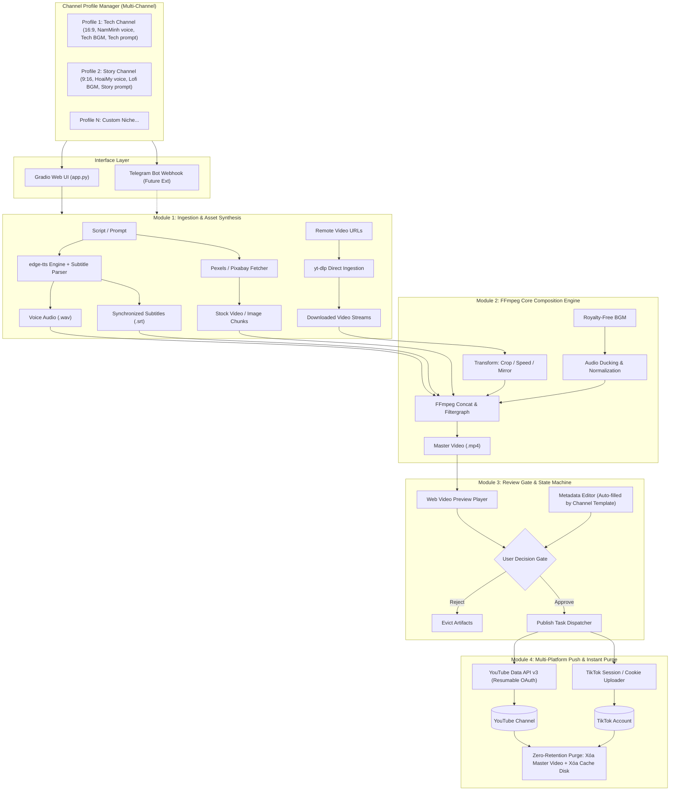

# System Architecture: Cloud Video Creation & Auto-Push Engine

## 1. High-Level Architecture Overview

The system is a decoupled, cloud-native automated media processing pipeline designed to run on resource-constrained free cloud instances (e.g., Hugging Face Spaces: 2 vCPU, 16 GB RAM, 50 GB ephemeral disk). It completely offloads compute, networking, and rendering workloads from local workstations.



---

## 2. Multi-Layer Heavy Video Workload Architecture

Xử lý video nặng (video dài 15-60 phút, nhiều lớp layer, sub, nhạc) trên máy chủ yếu (2 vCPU / 16GB RAM) chia thành **4 Layer độc lập**:

```text
+---------------------------------------------------------------------------------+
| LAYER 1: INGESTION & ASYNC TASK QUEUE (Không treo UI)                           |
| - Gradio UI / Telegram Webhook đẩy Job vào SQLite Queue                         |
| - Concurrency Limit = 1 (Xếp hàng tuần tự, chống nghẽn CPU)                   |
+----------------------------------------+----------------------------------------+
                                         |
                                         v
+---------------------------------------------------------------------------------+
| LAYER 2: ASSET NORMALIZATION (Chuẩn hóa nguyên liệu)                            |
| - Tải stream trực tiếp về disk (yt-dlp / httpx chunked 8MB)                     |
| - Chuẩn hóa ngay lập tức về Mezzanine Format (720p/1080p, 30fps CFR, 44.1kHz)   |
| - Tránh xung đột codec và tránh decode 4K gây tràn RAM                         |
+----------------------------------------+----------------------------------------+
                                         |
                                         v
+---------------------------------------------------------------------------------+
| LAYER 3: CHUNKED COMPOSITION ENGINE (Dựng phân đoạn + Ghép không re-encode)    |
| - Chia video dài thành N phân đoạn nhỏ (1-2 phút/chunk)                         |
| - Render từng chunk độc lập: RAM luôn ổn định dưới 1.5GB                       |
| - Concat demuxer (-f concat -c copy): Ghép các chunk thành Master trong 2 giây |
| - Two-Tier Render:                                                              |
|   * Preview Pass: 480p ultrafast (5-10s) -> gửi người dùng duyệt                |
|   * Master Pass: 1080p superfast -> chỉ chạy khi có lệnh [Approve]             |
+----------------------------------------+----------------------------------------+
                                         |
                                         v
+---------------------------------------------------------------------------------+
| LAYER 4: ZERO-RETENTION PURGE & RESUMABLE MULTI-PLATFORM PUSH                   |
| - Resumable Upload: Đẩy video lên YouTube/TikTok dạng chunk 8MB-16MB            |
|   (Rớt mạng tự resume, không phải upload lại từ đầu)                            |
| - Zero-Retention Policy: Ngay khi nhận HTTP 200 OK từ YouTube / TikTok:         |
|   * Xóa vĩnh viễn Master Video (.mp4)                                           |
|   * Xóa sạch toàn bộ chunk thô, audio, srt và cache tạm trong thư mục           |
|   * Chỉ lưu lại 1 dòng metadata log (Video ID, link public, timestamp)          |
|   * Ổ đĩa trở về 0 MB sử dụng cho tác vụ tiếp theo                             |
+---------------------------------------------------------------------------------+
```

---

## 3. Core Subsystems & Technical Specifications

### 3.1 Multi-Channel Profile Manager (`core/channel_manager.py`)

- **Channel Persona Architecture**:
  - Hỗ trợ xây dựng không giới hạn số lượng kênh (ví dụ: Kênh Công nghệ, Kênh Triết học/Tâm sự, Kênh Tin tức 24h...).
  - Mỗi kênh lưu trong file cấu hình độc lập `channels/<channel_id>.json` gồm các thông số:
    1. **Identity & Niche:** Tên kênh, chủ đề, định dạng khung hình (16:9 Landscape hoặc 9:16 Portrait).
    2. **Tone & Prompt Template:** Khung sườn prompt AI (ví dụ: phong cách phân tích sâu, hài hước, kịch tính). Khi nhập prompt thô, hệ thống tự wrap vào format riêng của kênh.
    3. **Audio & Visual Presets:**
       - Giọng đọc riêng (nam/nữ, tốc độ, ngữ điệu).
       - Thư viện BGM riêng theo vibe (cyberpunk/tech, lofi chill, epic cinematic).
       - Subtitle style riêng (màu chữ, viền, font chữ).
    4. **Platform Credentials Binding:** Gắn riêng tài khoản YouTube (Client ID/Token) và TikTok (Cookie/Session) tương ứng cho từng kênh.
    5. **Metadata Templates:** Mẫu tiêu đề chuẩn SEO, mô tả có sẵn link/call-to-action, danh sách hashtag cố định.

### 3.2 Interface & Session Layer (`app.py`, `ui/`)

- **Gradio 4.x / 5.x Reactive Architecture**:
  - Stateless frontend components paired with backend session generators.
  - Dropdown **Chọn Kênh (Channel Selector)** ngay đầu trang: đổi kênh -> tự động load toàn bộ cấu hình, prompt template, giọng đọc, BGM và tài khoản đích.
  - Progress feedback using `gr.Progress(track_tqdm=True)` to stream FFmpeg percentage to UI.
  - Tab 1: **AI Story Generator** (Topic/Text -> TTS -> Stock -> Video).
  - Tab 2: **Video Remix & Downloader** (URLs -> Downloader -> Clipper -> Video).
  - Tab 3: **Review & Publish Gate** (HTML5 Video Player + Metadata fields + Action triggers).
  - Tab 4: **Channel & Credentials Manager** (Thêm/Sửa Channel Profile, cập nhật token).

### 3.3 Ingestion & Synthesis Engine (`core/`)

- **TTS & Subtitle Alignment (`core/tts_engine.py`)**:
  - Uses asynchronous Microsoft `edge-tts`.
  - Zero cost, no API key required, supports natural neural voices (`vi-VN-HoaiMyNeural`, `vi-VN-NamMinhNeural`, `en-US-ChristopherNeural`).
  - Word-boundary timestamp callback extraction to synthesize frame-accurate `.srt` / `.ass` subtitles.
- **Stock Media Fetcher (`core/stock_fetcher.py`)**:
  - Queries Pexels / Pixabay REST APIs with extracted semantic keywords.
  - Downloads 1080p MP4 clips direct to container disk with connection pooling (`httpx`).
  - Fallback pipeline: generates Ken Burns zoom effects over high-resolution static images if stock footage is unavailable.
- **Media Ingestion (`core/downloader.py`)**:
  - Direct cloud-stream ingestion using `yt-dlp`.
  - Configured with strict format constraints (`bestvideo[height<=1080]+bestaudio/best[height<=1080]`).
  - Native stream extraction avoids re-encoding before montage.

### 3.3 FFmpeg Composition Pipeline (`core/ffmpeg_builder.py`)

- **Resource-Constrained Encoding Strategy**:
  - Target profiles:
    - Landscape (16:9): `1920x1080`, 30 fps, `libx264`, preset `superfast`, CRF 23, AAC 128k.
    - Portrait (9:16): `1080x1920`, 30 fps, `libx264`, preset `superfast`, CRF 23, AAC 128k.
  - Two-stage processing:
    1. *Draft / Preview Mode:* Encoded at 720p with `ultrafast` preset for instant web review (render time < 30s).
    2. *Final Master Mode:* Full 1080p render executed only after user presses [Approve].
- **Audio Ducking Filtergraph**:
  - Sidechain compression via FFmpeg `sidechaincompress` or `amix` to dip background music volume by -18 dB whenever voiceover is active.
- **Subtitle Styling**:
  - Burned subtitles using `subtitles` filter with custom font configurations (Montserrat / BeVietnamPro, bold, outline=2, shadow=1).

### 3.4 State Management & Review Gate (`core/state_manager.py`)

- Single-direction state machine per render job:
  `IDLE -> INGESTING -> RENDERING_PREVIEW -> AWAITING_REVIEW -> PUBLISHING -> COMPLETED (or FAILED)`
- Persistent task metadata stored in lightweight local SQLite or JSON ledger.
- Idempotency key per job prevents double-posting to YouTube / TikTok if button clicked multiple times.

### 3.5 Multi-Platform Publisher (`core/uploader/`)

- **YouTube Publisher (`youtube.py`)**:
  - Google API Client (`google-api-python-client`).
  - Resumable file upload protocol with exponential backoff on HTTP 5xx errors.
  - OAuth2 credential flow: stores `refresh_token` in persistent environment variables / Hugging Face Secrets (`YOUTUBE_REFRESH_TOKEN`, `YOUTUBE_CLIENT_ID`, `YOUTUBE_CLIENT_SECRET`).
- **TikTok Publisher (`tiktok.py`)**:
  - Dual upload strategy:
    1. Primary: Session cookie authentication uploader.
    2. Secondary: Direct video download link with one-click clipboard copy of title/tags for manual assist.

---

## 4. Resource Management & Constraints

| Resource | Constraint | Mitigation Strategy |
| :--- | :--- | :--- |
| **CPU** | 2 vCPU shared | Use FFmpeg `threads=2`, preset `superfast`. Avoid simultaneous renders. |
| **RAM** | 16 GB | Stream media via FFmpeg pipes; avoid loading full uncompressed frames into Python memory. |
| **Disk** | 50 GB Ephemeral | Automated garbage collection (`cron_cleanup`): delete raw clips immediately after master render; delete all output files older than 6 hours. |
| **API Limits** | YouTube 10k quota/day | 1 video upload cost = 1,600 units (~6 uploads/day). Cache channel info; avoid unnecessary API queries. |

---

## 5. Security & Credential Isolation

- **Zero Hardcoded Secrets**: All tokens (`PEXELS_API_KEY`, `YOUTUBE_CLIENT_SECRET`, etc.) injected via environment variables or Gradio UI password fields.
- **Sanitized Filenames & Inputs**: All URL parameters, titles, and text strings pass regex sanitization before being injected into FFmpeg CLI arguments or shell processes to prevent command injection.
- **Transient Data**: User cookies and credentials stored in memory during session only, never logged or committed to git.

---

## 6. Extension Path: Telegram Bot Bridge

The core engine in `core/` is completely decoupled from Gradio:

```text
CLI / Webhook / Bot  ───►  PipelineController (core/pipeline.py)
                                    │
                                    ├─── Ingest
                                    ├─── Compose (FFmpeg)
                                    └─── Publish (YouTube/TikTok)
```

To attach a Telegram Bot in Phase 2:

1. Spin up `python-telegram-bot` runner alongside Gradio or as an independent worker.
2. Direct bot commands (`/story`, `/remix`) into `PipelineController`.
3. Send preview video via Telegram `send_video` with Inline Keyboard (`[Approve]`, `[Regenerate]`).
