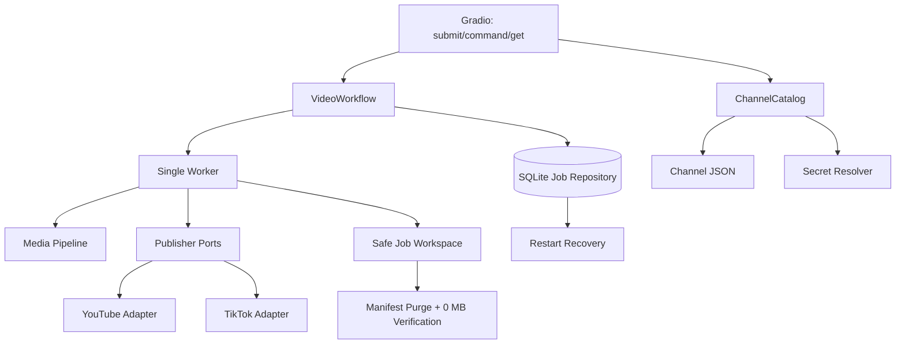

# ARCHITECTURE REVIEW & IMPROVEMENT PROPOSAL

| Thuộc tính | Giá trị |
|---|---|
| Mã tài liệu | AR-NVP-001 |
| Ngày review | 15/11/2026 |
| Phạm vi | `ARCHITECTURE.md`, BA, design spec, implementation plan và code hiện tại |
| Trạng thái | Chờ chủ dự án duyệt |

## 1. Kết luận nhanh

Kiến trúc hiện tại có hướng đúng: core tách Gradio, hai tầng render, Review Gate, giới hạn tài nguyên và Zero-Retention. Tuy nhiên chưa nên triển khai tiếp uploader/purge theo tài liệu hiện tại trước khi xử lý các điểm P0. Rủi ro lớn nhất không nằm ở FFmpeg mà ở persistence, idempotency, điều kiện purge và phạm vi xóa file.

Không đề xuất sửa trực tiếp `ARCHITECTURE.md` trước khi các quyết định dưới đây được duyệt.

## 2. Điểm đang làm tốt

- Phân tách `app.py` và `core/` rõ ràng; core không phụ thuộc Gradio.
- Có Review Gate thay vì tự động đăng nội dung chưa duyệt.
- Nhận diện đúng giới hạn 2 vCPU/disk ephemeral và dùng concurrency 1.
- Có preview/master hai tầng để giảm chi phí render.
- Đã đưa network timeout, backoff, resumable upload và cleanup vào yêu cầu.
- Có định hướng test mock cho external API và cấm `shell=True`.

## 3. Các cải thiện P0 — phải chốt trước khi xây uploader/purge

### ARC-P0-01 — Điều kiện purge đang mâu thuẫn

**Hiện trạng:** Sơ đồ và một số đoạn mô tả có thể được hiểu là nhận HTTP 200 từ một nền tảng thì xóa master; BA yêu cầu đợi tất cả nền tảng đích.

**Rủi ro:** YouTube thành công, TikTok thất bại nhưng master đã bị xóa nên không thể retry.

**Đề xuất:** Chỉ purge khi mọi target đã `SUCCEEDED`, hoặc target còn lại được người dùng xác nhận `SKIPPED`. Persist receipt trước purge.

- [ ] Duyệt đề xuất
- [ ] Yêu cầu sửa

### ARC-P0-02 — State/queue chưa được persist

**Hiện trạng:** `ARCHITECTURE.md` nói SQLite/JSON ledger và queue, nhưng `StateManager` hiện chỉ dùng dictionary trong RAM. Restart làm mất job, idempotency và artifact manifest.

**Rủi ro:** Đăng trùng, orphan file, không thể biết upload đã thành công hay chưa.

**Đề xuất:** SQLite + WAL, migration có version, atomic claim và optimistic concurrency. In-memory repository chỉ dùng cho test.

- [ ] Duyệt SQLite cho MVP
- [ ] Chọn persistence khác

### ARC-P0-03 — Purge chưa giới hạn workspace an toàn

**Hiện trạng:** `register_temp_file()` nhận đường dẫn bất kỳ, resolve rồi `unlink`. Không có kiểm tra file phải nằm trong thư mục job.

**Rủi ro:** Bug hoặc input sai có thể xóa file ngoài job.

**Đề xuất:** Mỗi job có workspace do hệ thống tạo; DB chỉ lưu relative path; mọi delete kiểm tra containment và không follow symlink ra ngoài root. Purge dựa trên manifest, sau đó scan xác minh 0 MB.

- [ ] Duyệt đề xuất
- [ ] Yêu cầu cơ chế khác

### ARC-P0-04 — Idempotency chưa có mô hình dữ liệu

**Hiện trạng:** Tài liệu nêu idempotency key nhưng `VideoJob` chỉ có `published_urls`; chưa có target status, attempt, upload session hoặc unique constraint.

**Rủi ro:** Double-click/restart/timeout có thể đăng trùng.

**Đề xuất:** Bảng `publish_targets` và `publish_attempts`, unique theo `job_id + platform + approval_revision`; có trạng thái `UNKNOWN` và reconcile trước retry.

- [ ] Duyệt đề xuất
- [ ] Yêu cầu sửa

### ARC-P0-05 — Credential theo kênh chưa khớp config hiện tại

**Hiện trạng:** BA/Architecture yêu cầu credential riêng từng kênh, nhưng `AppConfig` chỉ có một bộ `YOUTUBE_*` toàn ứng dụng.

**Rủi ro:** Đăng nhầm kênh hoặc lộ credential qua channel JSON/UI.

**Đề xuất:** Channel Profile chỉ lưu `credential_ref`; secret value nằm trong Hugging Face Secrets/environment và được resolve lúc publish. Tab credential phải có authentication nếu deployment public.

- [ ] Duyệt secret reference theo kênh
- [ ] Chấp nhận một tài khoản chung cho MVP

### ARC-P0-06 — Loại bỏ mô tả “copyright masking”

**Hiện trạng:** Design spec mô tả mirror/crop như biện pháp “copyright masking”.

**Rủi ro:** Tạo kỳ vọng sai về bản quyền và có thể khuyến khích sử dụng nội dung không có quyền.

**Đề xuất:** Chỉ giữ mirror/crop như hiệu ứng biên tập hợp lệ; bắt buộc cảnh báo và xác nhận quyền sử dụng nguồn.

- [ ] Duyệt loại bỏ thuật ngữ/ý định né bản quyền
- [ ] Yêu cầu sửa

## 4. Các cải thiện P1 — cần hoàn thành trước MVP production

### ARC-P1-01 — Chuẩn hóa state machine

**Vấn đề:** Architecture thiếu `RENDERING_MASTER` trong chuỗi chính, code lại có; chưa có `QUEUED`, `PURGING`, `CANCELLED`. `IDLE` không mang nhiều ý nghĩa sau khi job đã tồn tại.

**Đề xuất:** Dùng `QUEUED → INGESTING → RENDERING_PREVIEW → AWAITING_REVIEW → RENDERING_MASTER → PUBLISHING → PURGING → COMPLETED`, cộng `FAILED/CANCELLED`. Publish status được theo dõi riêng từng target.

- [ ] Duyệt

### ARC-P1-02 — Chốt một chuẩn preview và sửa thứ tự render

**Vấn đề:** Tài liệu có cả 480p và 720p; sơ đồ lớn thể hiện final render trước Review Gate, trong khi yêu cầu nói master chỉ dựng sau approve.

**Đề xuất:** Preview 480p; master 1080p sau approve. Sửa toàn bộ sơ đồ và bảng profile theo một chuẩn.

- [ ] Duyệt 480p
- [ ] Chọn 720p

### ARC-P1-03 — Thêm background worker thực sự

**Vấn đề:** Gradio callback không nên giữ request suốt quá trình render/upload dài. Tài liệu nêu queue nhưng chưa mô tả worker lifecycle, claim hay recovery.

**Đề xuất:** Một background worker, queue trong SQLite, UI poll `JobView`; startup recovery cho job bị ngắt.

- [ ] Duyệt

### ARC-P1-04 — Tách application interface khỏi adapter thấp

**Vấn đề:** Implementation plan để UI consume cả `PipelineController` và `ChannelManager`, trong khi pipeline interface còn phơi nhiều chi tiết.

**Đề xuất:** UI chỉ dùng `VideoWorkflow` và `ChannelCatalog`; external adapters là internal seams. Điều này giảm coupling và tạo test surface ổn định.

- [ ] Duyệt

### ARC-P1-05 — Xử lý upload có kết quả không xác định

**Vấn đề:** Retry/backoff mới nói về lỗi rõ ràng; chưa định nghĩa trường hợp timeout sau khi server đã nhận video.

**Đề xuất:** Target status `UNKNOWN`, reconcile bằng upload session/external lookup trước khi retry.

- [ ] Duyệt

### ARC-P1-06 — Phân biệt TTL draft và TTL publish failure

**Vấn đề:** Cleanup 6 giờ có thể xóa master đang chờ quota/credential được khắc phục.

**Đề xuất:** Draft TTL mặc định 6 giờ; master lỗi publish có TTL riêng, đề xuất 24 giờ hoặc cấu hình được. Job `UNKNOWN` không tự purge.

- [ ] Duyệt TTL publish failure 24 giờ
- [ ] Chọn thời hạn khác

### ARC-P1-07 — Làm rõ persistence trên Hugging Face

**Vấn đề:** Audit log được mô tả là persistent nhưng disk mục tiêu là ephemeral.

**Đề xuất:** Ghi rõ ba mức: process restart, Space restart còn volume, và Space rebuild mất ephemeral disk. Nếu audit bắt buộc tồn tại lâu dài, dùng persistent storage/external repository.

- [ ] Audit chỉ cần trong runtime volume
- [ ] Audit phải bền vững qua rebuild

### ARC-P1-08 — Bảo vệ deployment public

**Vấn đề:** Tab nhập token/cookie trong một Gradio Space public là rủi ro lớn; Architecture chưa có authentication/authorization.

**Đề xuất:** Bật app authentication hoặc tắt tab credential trên public deployment. Secret value không được đọc ngược ra UI.

- [ ] Duyệt

### ARC-P1-09 — Disk budget và admission control

**Vấn đề:** Ngưỡng 40 GB mới là cleanup trigger, chưa có ước lượng dung lượng job trước khi nhận.

**Đề xuất:** Preflight free space, estimate theo source/duration, reserve budget, từ chối hoặc xếp chờ nếu không đủ. Cleanup không được đụng job đang upload/unknown.

- [ ] Duyệt

## 5. Các cải thiện P2 — chất lượng và khả năng vận hành

| ID | Hiện trạng | Đề xuất |
|---|---|---|
| ARC-P2-01 | `ARCHITECTURE.md` bị lỗi mã hóa tiếng Việt ở nhiều đoạn | Chuyển toàn bộ sang UTF-8 và kiểm tra hiển thị Mermaid |
| ARC-P2-02 | Đánh số mục 3.3 bị lặp | Chuẩn hóa heading và liên kết mục lục |
| ARC-P2-03 | Chưa có error taxonomy | Định nghĩa validation/config/transient/quota/media/render/ambiguous/cleanup errors |
| ARC-P2-04 | Chưa có startup checks | Kiểm tra FFmpeg/ffprobe/filter/font/disk/migration/config khi khởi động |
| ARC-P2-05 | Chưa có observability contract | Structured logs, metric queue/render/upload/disk/purge; redaction bắt buộc |
| ARC-P2-06 | Chưa có migration strategy | Version SQLite schema và migration test |
| ARC-P2-07 | Dependency runtime/dev đang trộn | Tách hoặc chuyển sang `pyproject.toml` với lock strategy |
| ARC-P2-08 | Tài liệu nói mypy/pyright không thống nhất | Chọn một type checker làm CI gate |
| ARC-P2-09 | Chưa lưu provenance/license của stock/source | Lưu nguồn và license reference trong job đến khi hoàn tất/audit theo chính sách |
| ARC-P2-10 | Chưa có cancellation semantics | Chỉ hủy ở safe point, terminate FFmpeg có kiểm soát, sau đó purge |

## 6. Kiến trúc đề xuất sau cải thiện

Thay đổi trọng tâm là đưa orchestration và invariant vào một deep module, persist mọi quyết định có side effect, và coi purge là một phase có thể retry chứ không phải một lệnh xóa chạy sau HTTP 200.

## 7. Thứ tự cập nhật tài liệu sau khi duyệt

1. Chốt checkbox P0 và các quyết định preview/persistence/TTL.
2. Tạo ADR cho persistence, per-channel secret, upload idempotency và purge policy.
3. Cập nhật `ARCHITECTURE.md` theo kiến trúc mục tiêu.
4. Cập nhật implementation plan vì Task 2, 7 và 8 hiện chưa đủ cho persistence/idempotency/recovery.
5. Chỉnh `CLAUDE.md` để nêu safe workspace, target-level success và authentication invariant.
6. Mới bắt đầu vertical slice foundation → fake publish → purge.

## 8. Phiếu duyệt tổng hợp

| Quyết định | Lựa chọn đề xuất | Trạng thái |
|---|---|---|
| Job repository | SQLite + WAL | [ ] Duyệt |
| Preview | 480p | [ ] Duyệt |
| Purge | Sau mọi target thành công/được skip có xác nhận | [ ] Duyệt |
| Credential | Secret reference theo kênh | [ ] Duyệt |
| Public security | Bắt buộc authentication trước tab credential | [ ] Duyệt |
| Draft TTL | 6 giờ | [ ] Duyệt |
| Publish-failure TTL | 24 giờ hoặc cấu hình | [ ] Duyệt |
| Audit durability | Chọn runtime-only hoặc persistent storage | [ ] Cần chọn |
| TikTok MVP | Adapter + manual fallback | [ ] Duyệt |
| Type checker | Chọn mypy hoặc pyright | [ ] Cần chọn |

