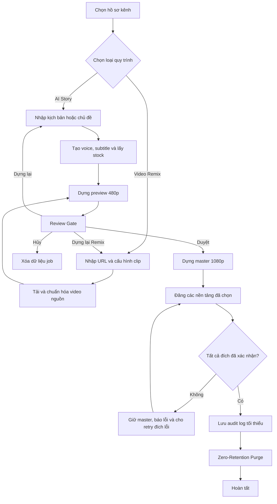
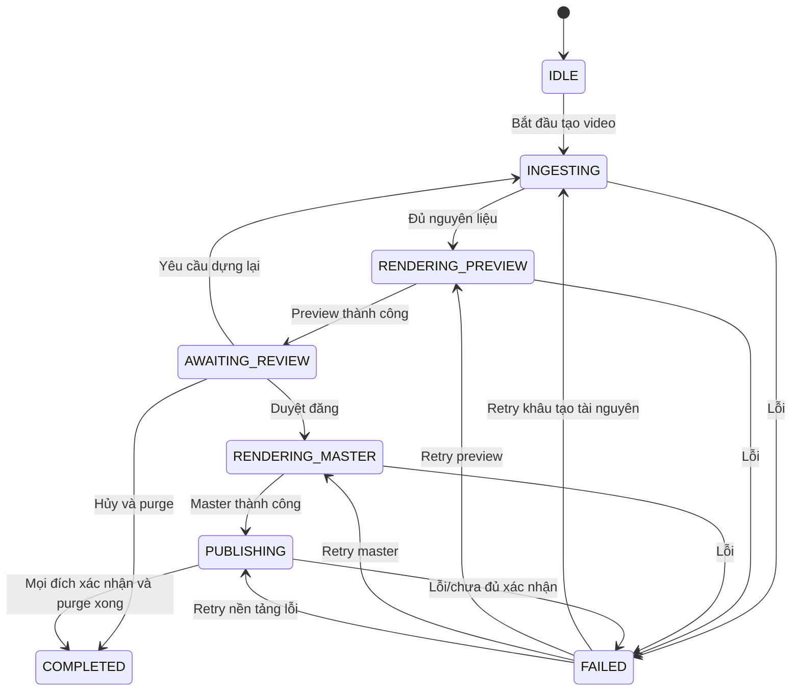

# TÀI LIỆU PHÂN TÍCH NGHIỆP VỤ (BA)

## Hệ thống Cloud Video Creation & Auto-Push

| Thuộc tính | Nội dung |
|---|---|
| Mã tài liệu | BA-NVP-001 |
| Phiên bản | 1.0 |
| Ngày lập | 15/11/2026 |
| Trạng thái | Dự thảo để xác nhận nghiệp vụ |
| Phạm vi | Tạo, dựng, duyệt và đăng video đa kênh lên YouTube/TikTok |
| Tài liệu tham chiếu | `ARCHITECTURE.md`, `CLAUDE.md`, Cloud Video Engine Design |

> Tài liệu này mô tả hệ thống mục tiêu (TO-BE). Một yêu cầu xuất hiện trong tài liệu không đồng nghĩa chức năng đó đã được triển khai.

---

## 1. Mục tiêu nghiệp vụ

Hệ thống giúp người vận hành sản xuất và đăng video mà không sử dụng tài nguyên máy cá nhân. Toàn bộ quá trình tải nguyên liệu, tạo giọng đọc, lấy stock footage, dựng video, duyệt nội dung và upload được thực hiện trên hạ tầng cloud.

Các mục tiêu chính:

1. Rút ngắn quy trình sản xuất video theo mẫu cho nhiều kênh.
2. Quản lý riêng persona, giọng đọc, nhạc nền, giao diện phụ đề và tài khoản đăng của từng kênh.
3. Hỗ trợ hai luồng sản xuất: **AI Story Generator** và **Video Remix**.
4. Bắt buộc có người duyệt nội dung trước khi công khai.
5. Hỗ trợ đăng lên YouTube và TikTok, chống đăng trùng khi thao tác lặp lại.
6. Không lưu trữ lâu dài video trên máy chủ; dữ liệu media phải được xóa sau khi hoàn tất hoặc hết hạn.

## 2. Phạm vi

### 2.1 Trong phạm vi

- Tạo, sửa, chọn và sử dụng hồ sơ kênh.
- Quản lý cấu hình persona, prompt, giọng đọc, BGM, phụ đề, tỷ lệ khung hình và mẫu metadata.
- Nhập kịch bản có sẵn hoặc chủ đề/prompt để chuẩn bị nội dung.
- Tạo voice-over và phụ đề đồng bộ bằng edge-tts.
- Tìm và tải stock video/hình ảnh từ Pexels/Pixabay; dùng phương án dự phòng khi không có video phù hợp.
- Tải video nguồn từ URL bằng yt-dlp và cắt/biến đổi theo cấu hình remix.
- Dựng preview 480p và master 1080p bằng FFmpeg.
- Duyệt, sửa metadata, dựng lại, hủy hoặc phê duyệt đăng.
- Đăng YouTube theo cơ chế resumable; đăng TikTok hoặc cung cấp phương án thủ công khi cơ chế tự động không khả dụng.
- Theo dõi trạng thái job, xử lý lỗi và dọn dữ liệu theo Zero-Retention Policy.
- Lưu nhật ký tối thiểu của nội dung đã đăng.

### 2.2 Ngoài phạm vi

- Trình biên tập timeline nhiều track như Premiere hoặc CapCut.
- Huấn luyện mô hình sinh video/giọng nói riêng.
- Lưu trữ thư viện video lâu dài trên máy chủ.
- Tự động công khai video khi chưa có thao tác phê duyệt của người dùng.
- Kiểm duyệt bản quyền thay cho người vận hành.
- Telegram Bot và các webhook ngoài Gradio trong giai đoạn hiện tại.

## 3. Bên liên quan và tác nhân

| Tác nhân | Trách nhiệm/nhu cầu |
|---|---|
| Người vận hành nội dung | Tạo job, nhập nội dung, xem preview, sửa metadata, duyệt hoặc hủy video |
| Quản trị kênh | Quản lý hồ sơ kênh, token, cookie, mẫu prompt, BGM và cấu hình đăng |
| Người duyệt nội dung | Kiểm tra hình, tiếng, phụ đề và metadata trước khi cho phép đăng |
| Hệ thống | Điều phối job, dựng video, upload, retry, chống đăng trùng và xóa dữ liệu |
| YouTube | Nhận video và trả kết quả/ID/URL đăng |
| TikTok | Nhận video và trả kết quả/ID/URL đăng, hoặc yêu cầu luồng hỗ trợ thủ công |
| Pexels/Pixabay | Cung cấp stock footage hoặc hình ảnh |
| edge-tts | Sinh giọng đọc và mốc thời gian phụ đề |

Một người có thể đồng thời giữ vai trò vận hành, quản trị và duyệt trong bản triển khai đơn người dùng.

## 4. Thuật ngữ nghiệp vụ

| Thuật ngữ | Định nghĩa |
|---|---|
| Channel Profile | Hồ sơ cấu hình độc lập của một kênh nội dung |
| Persona | Chủ đề, giọng điệu và phong cách nội dung của kênh |
| Job | Một yêu cầu sản xuất video từ lúc khởi tạo đến khi hoàn tất/thất bại |
| Preview | Bản dựng nhẹ 480p dùng để duyệt, không phải bản đăng cuối |
| Master | Bản dựng 1080p dùng để upload |
| Review Gate | Điểm kiểm soát bắt buộc để con người duyệt trước khi đăng |
| Target platform | Nền tảng được chọn làm đích đăng cho job, ví dụ YouTube/TikTok |
| Idempotency key | Khóa giúp một job không bị đăng trùng khi bấm hoặc retry nhiều lần |
| Zero-Retention | Chính sách xóa toàn bộ media của job khi đã đủ điều kiện |
| Audit log | Bản ghi nhẹ gồm kênh, tiêu đề, nền tảng, URL/ID và thời gian; không chứa media hoặc bí mật |

## 5. Quy trình nghiệp vụ tổng thể

## 6. Vòng đời job

Trạng thái `FAILED` không mặc định kích hoạt xóa master nếu job còn khả năng retry upload. Việc dọn dữ liệu khi lỗi phải tuân theo các quy tắc tại mục 8.

## 7. Yêu cầu nghiệp vụ và chức năng

### 7.1 BR-01 — Quản lý hồ sơ kênh

**Mục đích:** Tách biệt cấu hình nội dung và tài khoản đăng giữa các kênh.

**Dữ liệu tối thiểu của một hồ sơ:**

- Mã kênh duy nhất, tên hiển thị, niche/persona.
- Tỷ lệ khung hình mặc định: `16:9` hoặc `9:16`.
- Prompt template, tone và ngôn ngữ.
- Giọng đọc, tốc độ/ngữ điệu nếu được hỗ trợ.
- BGM và mức âm lượng/ducking.
- Font, màu, viền và kiểu phụ đề.
- Mẫu tiêu đề, mô tả, hashtag, category và privacy.
- Liên kết thông tin xác thực YouTube/TikTok của đúng kênh.

**Luồng chính:**

1. Quản trị tạo hoặc chọn hồ sơ kênh.
2. Hệ thống kiểm tra mã kênh và các trường bắt buộc.
3. Quản trị lưu cấu hình.
4. Khi người dùng đổi kênh tại đầu trang, hệ thống tải lại toàn bộ preset và tài khoản đích của kênh đó.

**Ngoại lệ:**

- Không cho lưu khi mã kênh trùng hoặc tỷ lệ khung hình không hợp lệ.
- Không hiển thị giá trị token/cookie ở dạng rõ sau khi lưu.
- Thiếu credential không ngăn tạo preview nhưng phải ngăn đăng lên nền tảng tương ứng.

**Tiêu chí nghiệm thu:**

- AC-01.1: Đổi kênh làm thay đổi đúng persona, giọng, BGM, subtitle, metadata và tài khoản đích.
- AC-01.2: Cấu hình của kênh A không bị dùng cho kênh B.
- AC-01.3: Bí mật không xuất hiện trong log, thông báo lỗi hoặc file cấu hình được commit.

### 7.2 BR-02 — Tạo video AI Story

**Tiền điều kiện:** Có hồ sơ kênh hợp lệ; người dùng đã nhập kịch bản hoặc chủ đề.

**Luồng chính:**

1. Người dùng chọn kênh và mở tab AI Story Generator.
2. Người dùng dán kịch bản hoặc nhập chủ đề/prompt.
3. Nếu là prompt, hệ thống bọc nội dung bằng prompt template của kênh và tạo kịch bản qua nhà cung cấp LLM đã cấu hình.
4. Người dùng kiểm tra/chỉnh kịch bản trước khi dựng.
5. Hệ thống dùng giọng của kênh để tạo audio và mốc thời gian subtitle.
6. Hệ thống trích từ khóa, tìm và tải stock footage phù hợp.
7. Hệ thống chuẩn hóa tài nguyên rồi dựng preview 480p.
8. Job chuyển sang `AWAITING_REVIEW`.

**Luồng thay thế/ngoại lệ:**

- Không có API key LLM: vẫn cho phép dùng kịch bản nhập trực tiếp.
- Không có video stock phù hợp: dùng ảnh hợp lệ với hiệu ứng Ken Burns hoặc nền dự phòng.
- TTS/lấy stock lỗi tạm thời: retry có giới hạn; hết số lần retry thì báo lỗi có thể hiểu được.
- Kịch bản rỗng hoặc chỉ có khoảng trắng: không tạo job.

**Tiêu chí nghiệm thu:**

- AC-02.1: Audio và subtitle được sinh theo đúng giọng/ngôn ngữ đã chọn.
- AC-02.2: Thời lượng hình đủ bao phủ voice-over, không để đoạn trống ngoài chủ ý.
- AC-02.3: Preview phát được trên trình duyệt và mang đúng tỷ lệ khung hình của kênh.
- AC-02.4: Chỉ tạo preview ở bước này; chưa dựng master và chưa upload.

### 7.3 BR-03 — Tạo video Remix

**Tiền điều kiện:** Có ít nhất một URL nguồn hợp lệ và người dùng có quyền sử dụng nội dung.

**Dữ liệu đầu vào:** URL, mốc bắt đầu/kết thúc, thứ tự clip, tốc độ, crop/tỷ lệ, mirror nếu được phép, âm thanh/BGM và phụ đề tùy chọn.

**Luồng chính:**

1. Người dùng chọn kênh và mở tab Video Remix.
2. Người dùng nhập một hoặc nhiều URL cùng cấu hình từng clip.
3. Hệ thống xác thực URL và tải trực tiếp về cloud, giới hạn nguồn tối đa 1080p.
4. Hệ thống chuẩn hóa codec, fps và audio của các clip.
5. Hệ thống cắt, crop, scale, đổi tốc độ và sắp thứ tự theo yêu cầu.
6. Hệ thống dựng preview 480p và chuyển sang Review Gate.

**Ngoại lệ:**

- URL không hợp lệ/không được hỗ trợ/phải đăng nhập: dừng clip tương ứng và nêu rõ nguyên nhân.
- Mốc thời gian ngoài độ dài video hoặc `start >= end`: không cho chạy.
- Một nguồn tải lỗi: không âm thầm bỏ qua; người dùng phải chọn retry hoặc loại nguồn.

**Tiêu chí nghiệm thu:**

- AC-03.1: Clip đầu ra đúng thứ tự và khoảng thời gian người dùng cấu hình.
- AC-03.2: Tất cả URL được kiểm tra trước khi truyền cho công cụ tải.
- AC-03.3: Preview đúng tỷ lệ, không sai lệch audio/video rõ rệt.
- AC-03.4: Hệ thống hiển thị cảnh báo trách nhiệm bản quyền trước khi tạo remix.

### 7.4 BR-04 — Dựng video và xử lý âm thanh

**Quy tắc dựng:**

- Preview: 480p, preset `ultrafast`, tối ưu cho duyệt nhanh.
- Master ngang: 1920x1080, 30 fps, H.264/AAC.
- Master dọc: 1080x1920, 30 fps, H.264/AAC.
- Master chỉ được dựng sau khi người dùng phê duyệt.
- Video dài được chia thành chunk nhỏ để ổn định RAM; các chunk đã chuẩn hóa được ghép không re-encode khi khả thi.
- Voice-over được ưu tiên; BGM phải tự giảm khi có lời nói, mục tiêu khoảng -18 dB so với voice.
- Subtitle được burn vào video theo preset kênh.

**Tiêu chí nghiệm thu:**

- AC-04.1: Preview và master có đúng profile tương ứng.
- AC-04.2: BGM không lấn voice-over và không clipping rõ rệt.
- AC-04.3: Subtitle hiển thị đúng thứ tự, không vỡ ký tự Unicode và nằm trong vùng an toàn.
- AC-04.4: Job khác không render đồng thời khi giới hạn concurrency bằng 1.
- AC-04.5: Lỗi dựng phải lưu thông báo kỹ thuật đã được làm sạch bí mật và cho phép retry phù hợp.

### 7.5 BR-05 — Review Gate

**Mục đích:** Không có video nào được đăng khi chưa có quyết định rõ ràng của con người.

**Thông tin hiển thị:** Preview player, kênh, loại job, thời lượng, tỷ lệ, trạng thái, tiêu đề, mô tả, tags, category, privacy và các nền tảng đích.

**Hành động:**

- **Duyệt & Đăng:** Khóa phiên bản nội dung/metadata hiện tại, dựng master và bắt đầu upload.
- **Dựng lại:** Quay về cấu hình, tạo preview mới; preview cũ được thay thế và dọn an toàn.
- **Hủy:** Xóa toàn bộ media tạm của job và kết thúc job.
- **Lưu metadata:** Cho phép sửa metadata trước khi phê duyệt.

**Tiêu chí nghiệm thu:**

- AC-05.1: Nút đăng chỉ khả dụng khi preview thành công, metadata hợp lệ và có ít nhất một nền tảng đích.
- AC-05.2: Bấm liên tiếp nút duyệt không tạo nhiều tác vụ đăng.
- AC-05.3: Thay đổi metadata sau khi bấm duyệt không làm thay đổi âm thầm payload đang upload.
- AC-05.4: Hủy job làm dung lượng media còn lại trong thư mục job bằng 0 MB, trừ audit log không chứa media.

### 7.6 BR-06 — Đăng YouTube và TikTok

**Luồng chính:**

1. Hệ thống kiểm tra master, credential và metadata của từng nền tảng đích.
2. Hệ thống tạo một idempotency key theo job và nền tảng.
3. YouTube sử dụng upload resumable theo chunk; lỗi mạng tạm thời được resume/retry với exponential backoff.
4. TikTok sử dụng cơ chế upload đã cấu hình; nếu phiên hết hạn, hệ thống thông báo và cung cấp phương án tải master kèm metadata để đăng thủ công.
5. Mỗi nền tảng thành công phải trả về xác nhận cùng video ID hoặc URL.
6. Hệ thống ghi kết quả riêng cho từng nền tảng.

**Quy tắc thất bại một phần:**

- Nếu YouTube thành công nhưng TikTok thất bại, job chưa được coi là `COMPLETED` khi cả hai đều là đích đã chọn.
- Không upload lại nền tảng đã thành công khi retry.
- Giữ master để retry nền tảng lỗi; không kích hoạt Zero-Retention cho tới khi tất cả đích đã xác nhận hoặc người dùng chủ động hủy các đích còn lại.
- Việc bỏ một đích sau thất bại phải có xác nhận rõ ràng và được ghi vào audit log.

**Tiêu chí nghiệm thu:**

- AC-06.1: Mỗi nền tảng nhận đúng credential của kênh đang chọn.
- AC-06.2: Retry không tạo video trùng trên nền tảng đã thành công.
- AC-06.3: Mất mạng giữa chừng không buộc YouTube upload lại từ byte đầu nếu phiên upload còn hiệu lực.
- AC-06.4: UI hiển thị trạng thái và URL/kết quả riêng cho từng nền tảng.

### 7.7 BR-07 — Zero-Retention và dọn dữ liệu

**Điều kiện purge tự động sau đăng:** Tất cả nền tảng đích còn hiệu lực của job đã trả xác nhận thành công.

**Dữ liệu phải xóa:**

- Video nguồn đã tải.
- Stock video/hình ảnh tạm.
- Chunk dựng, file chuẩn hóa và cache.
- Voice-over, BGM copy tạm, SRT/ASS.
- Preview và master.

**Dữ liệu được giữ:** Một audit row tối thiểu gồm job ID, channel ID, tiêu đề, nền tảng, video ID/URL, kết quả và timestamp. Không giữ nội dung kịch bản đầy đủ, media, token, cookie hoặc dữ liệu xác thực.

**Các tình huống khác:**

- Người dùng hủy job: purge ngay.
- Job nháp bị bỏ quên quá 6 giờ: purge tự động.
- Upload thất bại/không rõ kết quả: giữ master trong thời hạn xử lý; không suy đoán thành công rồi xóa.
- File đang bị khóa: retry dọn; job chỉ được đánh dấu hoàn tất khi xác minh không còn media.

**Tiêu chí nghiệm thu:**

- AC-07.1: Sau purge thành công, tổng dung lượng media trong thư mục riêng của job là 0 MB.
- AC-07.2: Audit log vẫn tra được URL/ID của video đã đăng.
- AC-07.3: Không purge master khi còn một nền tảng đích chưa xác nhận.
- AC-07.4: Thao tác purge có tính lặp lại an toàn; gọi lần hai không gây lỗi hoặc xóa ngoài phạm vi job.

### 7.8 BR-08 — Theo dõi, lỗi và khôi phục job

- UI phải hiển thị trạng thái hiện tại và tiến độ ở các khâu tải, TTS, dựng và upload.
- Lỗi phải nêu khâu bị lỗi, đối tượng liên quan và hành động tiếp theo; không lộ token/cookie.
- Retry phải tiếp tục từ điểm an toàn gần nhất khi có thể.
- Một thời điểm chỉ có một job render trên hạ tầng mục tiêu; các job còn lại xếp hàng FIFO, trừ khi người dùng hủy job đang chờ.
- Hệ thống phải phân biệt lỗi có thể retry, lỗi cần người dùng sửa dữ liệu và lỗi vĩnh viễn.

**Tiêu chí nghiệm thu:**

- AC-08.1: Refresh UI không tạo job hoặc upload mới.
- AC-08.2: Người dùng xem được lỗi và trạng thái cuối của từng nền tảng.
- AC-08.3: Job lỗi do input không hợp lệ không tự retry vô hạn.

## 8. Quy tắc nghiệp vụ

| Mã | Quy tắc |
|---|---|
| RULE-001 | Mọi job phải gắn với đúng một Channel Profile. |
| RULE-002 | Chỉ chấp nhận tỷ lệ `16:9` hoặc `9:16` trong giai đoạn hiện tại. |
| RULE-003 | Không được upload trước khi job ở `AWAITING_REVIEW` và người dùng xác nhận Duyệt & Đăng. |
| RULE-004 | Master 1080p chỉ dựng sau phê duyệt; preview không được dùng làm bản đăng mặc định. |
| RULE-005 | Mỗi cặp `job + nền tảng` chỉ được tạo một bản đăng logic. |
| RULE-006 | Chỉ đánh dấu hoàn tất đăng khi mọi nền tảng đích còn hiệu lực đã xác nhận thành công. |
| RULE-007 | Thành công một phần phải giữ master và chỉ retry nền tảng lỗi. |
| RULE-008 | Zero-Retention chỉ xóa file thuộc workspace đã đăng ký của job; không xóa theo đường dẫn do người dùng tùy ý truyền vào. |
| RULE-009 | Job hủy hoặc nháp quá 6 giờ được purge, không upload. |
| RULE-010 | Token/cookie không được ghi log, trả về UI dạng rõ hoặc commit vào Git. |
| RULE-011 | Nguồn bên ngoài phải có timeout, retry hữu hạn và backoff. |
| RULE-012 | Hệ thống không tự xác nhận quyền sử dụng nội dung; người vận hành chịu trách nhiệm về bản quyền. |
| RULE-013 | Nếu kết quả upload không xác định, hệ thống phải kiểm tra lại trạng thái trước khi retry để tránh đăng trùng. |
| RULE-014 | Người dùng muốn bỏ một nền tảng đã chọn sau lỗi phải xác nhận quyết định đó. |

## 9. Mô hình dữ liệu nghiệp vụ

### 9.1 Channel Profile

| Nhóm dữ liệu | Trường chính |
|---|---|
| Định danh | `channel_id`, `name`, `niche`, `language` |
| Nội dung | `persona`, `prompt_template`, `tone` |
| Hình ảnh | `aspect_ratio`, stock preferences, subtitle style |
| Âm thanh | `voice`, `rate`, `bgm`, ducking level |
| Metadata | title template, description template, hashtags, category, privacy |
| Liên kết bí mật | Tên/khóa tham chiếu đến credential YouTube/TikTok, không phải secret dạng rõ |

### 9.2 Video Job

| Trường | Ý nghĩa |
|---|---|
| `job_id` | Mã duy nhất của job |
| `channel_id` | Kênh sở hữu job |
| `job_type` | `AI_STORY` hoặc `REMIX` |
| `status` | Trạng thái trong vòng đời job |
| `aspect_ratio` | `16:9` hoặc `9:16` |
| `metadata` | Tiêu đề, mô tả, tags, category, privacy |
| `target_platforms` | Danh sách nền tảng đích đã chọn |
| `preview_path`/`master_path` | Đường dẫn nội bộ tạm thời |
| `publish_results` | Kết quả theo từng nền tảng |
| `error` | Lỗi đã làm sạch bí mật |
| `created_at`/`updated_at` | Thời điểm tạo và cập nhật |

### 9.3 Publish Result và Audit Log

Mỗi nền tảng cần lưu: tên nền tảng, trạng thái, external video ID, URL, số lần thử, thời gian xác nhận và lỗi cuối. Sau purge, chỉ giữ các trường audit cần thiết; loại bỏ đường dẫn file, session, token và payload nhạy cảm.

## 10. Yêu cầu phi chức năng

| Mã | Nhóm | Yêu cầu |
|---|---|---|
| NFR-01 | Hiệu năng | Hoạt động trong 2 vCPU, 16 GB RAM, 50 GB disk; FFmpeg tối đa 2 threads |
| NFR-02 | Ổn định | Chỉ một tiến trình render tại một thời điểm; video dài xử lý theo chunk để không tải toàn bộ frame vào RAM |
| NFR-03 | Bảo mật | Không hard-code hoặc log bí mật; input, URL và tên file phải được xác thực/làm sạch |
| NFR-04 | An toàn tiến trình | Không sử dụng `shell=True`; lệnh FFmpeg/yt-dlp được truyền bằng danh sách đối số |
| NFR-05 | Khả dụng | Request ngoài có timeout mặc định 30 giây và retry/backoff phù hợp với từng API |
| NFR-06 | Tương thích | Preview phát trên trình duyệt hiện đại; master dùng H.264/AAC MP4 |
| NFR-07 | Khả kiểm thử | Mọi API ngoài có thể mock; logic core không phụ thuộc Gradio |
| NFR-08 | Quan sát | Có tiến độ, lỗi theo khâu và audit kết quả đăng nhưng không ghi dữ liệu nhạy cảm |
| NFR-09 | Toàn vẹn | Trạng thái job và kết quả từng nền tảng không mất khi người dùng bấm lặp hoặc refresh UI |
| NFR-10 | Dung lượng | Sau hoàn tất/hủy/purge job, media còn lại phải bằng 0 MB trong workspace job |

## 11. Phân quyền và bảo mật nghiệp vụ

Phiên bản đầu có thể chạy theo mô hình một người dùng tin cậy. Nếu triển khai public hoặc nhiều người dùng, phải bổ sung xác thực và tối thiểu ba quyền:

- **Operator:** tạo job và chỉnh nội dung.
- **Reviewer:** duyệt/hủy và khởi tạo đăng.
- **Admin:** quản lý kênh, credential và chính sách.

Chỉ Admin được cập nhật credential. Giá trị bí mật sau khi nhập chỉ hiển thị dạng che; hệ thống chỉ lưu trong secret store hoặc biến môi trường phù hợp.

## 12. Báo cáo và nhật ký

Hệ thống cần hỗ trợ tra cứu tối thiểu theo job, kênh, nền tảng, trạng thái và khoảng thời gian. Mỗi bản ghi hoàn tất gồm:

- Job ID và Channel ID.
- Tiêu đề tại thời điểm duyệt.
- Nền tảng, external video ID và URL.
- Trạng thái cuối, thời gian duyệt, thời gian đăng và thời gian purge.
- Quyết định bỏ nền tảng (nếu có) và người xác nhận khi hệ thống đã có quản lý tài khoản.

Không dùng audit log làm nơi lưu kịch bản, media, token hoặc cookie.

## 13. Ma trận truy vết yêu cầu – kiểm thử

| Nghiệp vụ | Nhóm kiểm thử bắt buộc |
|---|---|
| BR-01 | Tách biệt cấu hình nhiều kênh, validation, che bí mật |
| BR-02 | TTS/SRT, stock fallback, script rỗng, preview đúng profile |
| BR-03 | URL/mốc thời gian, tải lỗi, thứ tự clip, cảnh báo bản quyền |
| BR-04 | Preview/master profile, ducking, subtitle Unicode, concurrency |
| BR-05 | Không đăng trước duyệt, double-click, hủy và 0 MB |
| BR-06 | Mock YouTube/TikTok, resumable/retry, lỗi một phần, idempotency |
| BR-07 | Purge đủ file, purge lặp, file khóa, không xóa ngoài job |
| BR-08 | State transition, refresh UI, retry hữu hạn, FIFO queue |

## 14. Rủi ro và phụ thuộc

| Rủi ro/phụ thuộc | Tác động | Hướng xử lý |
|---|---|---|
| YouTube quota giới hạn | Không thể đăng tiếp trong ngày | Hiển thị quota/lỗi, giữ master trong thời hạn retry |
| TikTok thay đổi cơ chế session/API | Upload tự động có thể ngừng | Cô lập uploader, cảnh báo hết phiên, duy trì phương án tải thủ công |
| Stock API thiếu kết quả hoặc hết quota | Thiếu hình minh họa | Fallback ảnh/Ken Burns/nền mặc định |
| Cloud restart hoặc disk ephemeral | Mất job/media đang xử lý | Lưu state nhẹ phù hợp; thông báo giới hạn và cho tạo lại job |
| Video dài vượt tài nguyên | Dựng chậm hoặc đầy disk | Giới hạn 1080p, chunking, concurrency 1, kiểm tra disk trước job |
| Nội dung nguồn vi phạm bản quyền | Khiếu nại hoặc khóa tài khoản | Cảnh báo/xác nhận quyền sử dụng, không quảng bá biến đổi để né bản quyền |
| Xóa sớm sau thành công một phần | Không thể retry nền tảng lỗi | Chỉ purge khi tất cả đích xác nhận hoặc người dùng bỏ đích rõ ràng |

## 15. Các điểm cần Product Owner xác nhận

1. Nhà cung cấp LLM nào được hỗ trợ chính thức cho bước tạo kịch bản và giới hạn chi phí/quota.
2. TikTok sẽ dùng API chính thức, session uploader hay chỉ hỗ trợ tải thủ công trong bản phát hành đầu.
3. Thời hạn 6 giờ cho job bỏ quên có áp dụng cả master đang chờ retry do quota hay cần một thời hạn riêng dài hơn.
4. Privacy mặc định của YouTube/TikTok là `private`, `unlisted` hay `public`.
5. Có cần tách người tạo và người duyệt hay chấp nhận cùng một người trong MVP.
6. Có lưu lịch sử kịch bản/metadata để tái sử dụng hay tuân thủ Zero-Retention ở mức chỉ giữ audit tối thiểu.
7. Giới hạn đầu vào cho số URL, dung lượng, độ dài video và thời lượng tối đa của một job.

## 16. Định nghĩa hoàn thành nghiệp vụ (Business Definition of Done)

Một phiên bản được coi là đáp ứng nghiệp vụ MVP khi:

1. Người dùng quản lý và chọn được nhiều hồ sơ kênh tách biệt.
2. Cả AI Story và Video Remix tạo được preview đúng profile.
3. Không thể upload nếu chưa qua Review Gate.
4. Master 1080p chỉ được dựng sau duyệt.
5. YouTube/TikTok trả kết quả riêng, retry không đăng trùng và xử lý đúng thành công một phần.
6. Dữ liệu media được purge đúng điều kiện và kiểm chứng còn 0 MB.
7. Bí mật không xuất hiện trong source, log hoặc UI.
8. Các tiêu chí nghiệm thu và test tương ứng của BR-01 đến BR-08 đều đạt.

