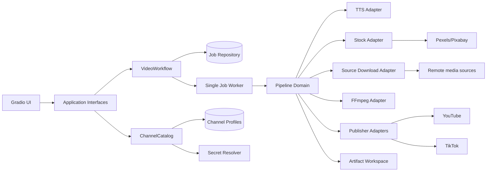
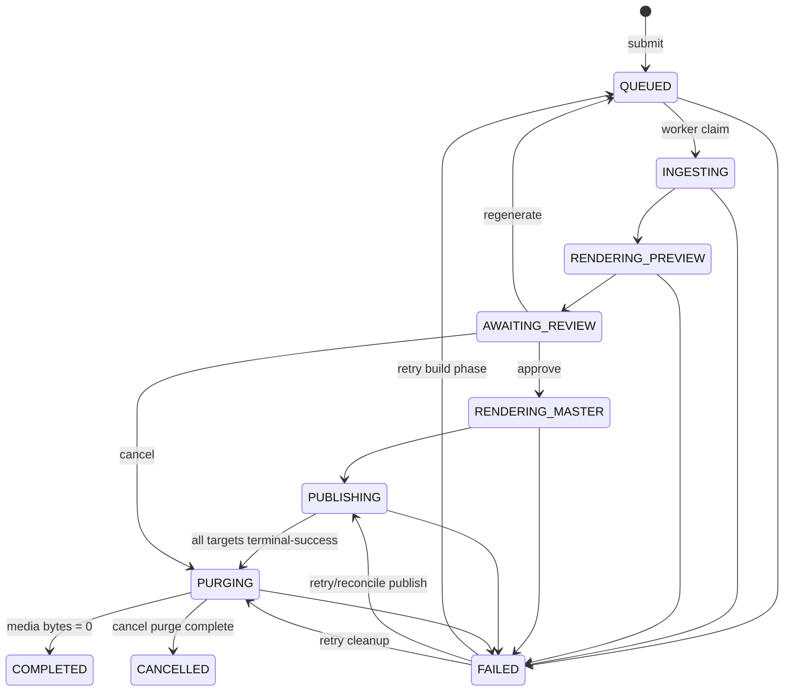

# TECHNICAL DESIGN — CLOUD VIDEO CREATION & AUTO-PUSH

| Thuộc tính | Giá trị |
|---|---|
| Mã tài liệu | TD-NVP-001 |
| Phiên bản | 1.0 |
| Ngày lập | 15/11/2026 |
| Trạng thái | Proposed — chờ duyệt các quyết định tại mục 17 |
| Phạm vi | MVP: AI Story, Video Remix, Review Gate, YouTube/TikTok publishing, Zero-Retention |
| Nguồn yêu cầu | `docs/BA_BUSINESS_REQUIREMENTS.md` |

> Đây là thiết kế mục tiêu (TO-BE), không phải mô tả đầy đủ code hiện tại. Khi có xung đột, BA đã được duyệt và ADR đã được chấp thuận là nguồn quyết định cao hơn tài liệu này.

> **Implementation status (Modules 3-13):** the as-built runtime uses PostgreSQL, separate durable workers, official provider APIs, verified purge, application authentication/roles, and the container topology documented in `README.md` and `docs/MODULE_9_OPERATIONS.md` through `docs/MODULE_13_DEPLOYMENT.md`. Earlier SQLite/single-worker passages below are retained as design history and are superseded by those operations guides.

---

## 1. Mục tiêu thiết kế

Thiết kế phải bảo đảm:

1. UI Gradio chỉ gọi một interface ứng dụng nhỏ, không điều phối trực tiếp FFmpeg, TTS hay uploader.
2. Mỗi job có trạng thái bền vững trong phạm vi runtime volume và có thể phục hồi sau khi tiến trình restart.
3. Review Gate là điều kiện bắt buộc trước khi dựng master và upload.
4. Upload có idempotency theo từng nền tảng, xử lý được thành công một phần.
5. Zero-Retention chỉ chạy khi đủ điều kiện và chỉ xóa artifact thuộc workspace của job.
6. External dependencies có adapter production và fake/mock adapter cho kiểm thử.
7. Chạy được trên 2 vCPU, 16 GB RAM và disk giới hạn 50 GB.

## 2. Nguyên tắc thiết kế

### 2.1 Deep module và seam

Hai module nghiệp vụ được trình bày ra UI:

- **VideoWorkflow:** nhận yêu cầu, nhận command và trả `JobView`. Toàn bộ orchestration, state transition, idempotency và purge nằm sau interface này.
- **ChannelCatalog:** liệt kê, đọc và cập nhật Channel Profile; không trả secret dạng rõ.

Các seam cho dịch vụ ngoài chỉ xuất hiện nơi có ít nhất hai adapter hợp lệ: adapter production và adapter fake/mock dùng trong test. FFmpeg, edge-tts, Pexels, yt-dlp, YouTube và TikTok là chi tiết implementation nằm sau `VideoWorkflow`, không bị lộ ra UI.

### 2.2 Các invariant bắt buộc

- `core/` không import Gradio.
- Không sử dụng `shell=True`.
- Không chuyển sang dựng master nếu chưa có approval hợp lệ.
- Không upload cùng một `job_id + platform` thành hai bản logic.
- Không purge nếu còn target chưa `SUCCEEDED` hoặc chưa được người dùng xác nhận `SKIPPED`.
- Không xóa đường dẫn nằm ngoài `temp/jobs/<job_id>/` hoặc `outputs/jobs/<job_id>/`.
- Không ghi token, cookie, refresh token hoặc secret value vào model, SQLite, log hay audit.

## 3. Kiến trúc runtime mục tiêu



### 3.1 Mô hình triển khai MVP

- Một Python process chạy Gradio và một background worker.
- UI request chỉ tạo command/job rồi trả nhanh; không giữ HTTP request trong toàn bộ thời gian render.
- Worker claim tối đa một job có tác vụ nặng tại một thời điểm.
- SQLite lưu job queue, transition, artifact manifest và publish receipt.
- Mỗi thread/process mở SQLite connection riêng; bật WAL và `busy_timeout`.
- FFmpeg chạy bằng subprocess argument list, giới hạn `-threads 2`.

SQLite trên ephemeral disk chỉ phục hồi được khi process restart nhưng volume còn tồn tại. Muốn audit tồn tại qua việc Space bị recreate phải dùng persistent volume hoặc repository adapter bên ngoài; đây là quyết định cần duyệt.

## 4. Cấu trúc source đề xuất

```text
NewVideo_Push/
├── app.py
├── config.py
├── core/
│   ├── application/
│   │   ├── video_workflow.py       # interface ứng dụng + orchestration
│   │   ├── channel_catalog.py      # interface quản lý hồ sơ kênh
│   │   └── commands.py             # request/command/result models
│   ├── domain/
│   │   ├── models.py               # Job, Target, Artifact, Metadata
│   │   ├── state_machine.py        # transition và invariant
│   │   ├── policies.py             # approval, purge, retry, disk policies
│   │   └── errors.py               # error taxonomy
│   ├── adapters/
│   │   ├── persistence/
│   │   │   ├── sqlite_jobs.py
│   │   │   └── json_channels.py
│   │   ├── media/
│   │   │   ├── edge_tts.py
│   │   │   ├── pexels.py
│   │   │   ├── yt_dlp.py
│   │   │   └── ffmpeg.py
│   │   ├── publishing/
│   │   │   ├── youtube.py
│   │   │   └── tiktok.py
│   │   └── secrets/
│   │       └── environment.py
│   ├── worker.py
│   └── workspace.py
├── channels/
├── migrations/
├── tests/
│   ├── contract/
│   ├── integration/
│   └── unit/
└── docs/
```

Có thể triển khai dần từ cấu trúc hiện tại, không cần di chuyển file hàng loạt ngay. Ưu tiên tạo `VideoWorkflow`, state machine và repository seam trước; adapter cũ được đưa vào sau interface theo từng vertical slice.

## 5. Interface ứng dụng

### 5.1 VideoWorkflow

Interface ngoài chỉ có ba hành vi:

```python
class VideoWorkflow(Protocol):
    def submit(self, request: StoryRequest | RemixRequest) -> JobView: ...
    def command(self, job_id: str, command: JobCommand) -> JobView: ...
    def get(self, job_id: str) -> JobView: ...
```

`JobCommand` là tagged union:

- `Approve(metadata, target_platforms, expected_revision)`
- `Regenerate(changes, expected_revision)`
- `Cancel(reason, expected_revision)`
- `Retry(scope, expected_revision)`
- `SkipTarget(platform, reason, expected_revision)`

`expected_revision` dùng optimistic concurrency để ngăn hai tab hoặc hai lần click ghi đè nhau. `JobView` chỉ chứa dữ liệu an toàn để hiển thị, không chứa filesystem path tuyệt đối hoặc secret.

### 5.2 ChannelCatalog

```python
class ChannelCatalog(Protocol):
    def list(self) -> list[ChannelSummary]: ...
    def get(self, channel_id: str) -> ChannelProfileView: ...
    def save(self, request: SaveChannelRequest) -> ChannelProfileView: ...
```

Channel Profile lưu `credential_ref`, ví dụ `youtube_secret_ref="YT_TECH"`; secret resolver ánh xạ reference này sang biến môi trường. Interface không có phương thức đọc lại secret value.

### 5.3 Internal ports

Các port sau chỉ được inject vào implementation của `VideoWorkflow`:

```python
class JobRepository(Protocol):
    def create(self, job: VideoJob) -> None: ...
    def get(self, job_id: str) -> VideoJob | None: ...
    def save(self, job: VideoJob, expected_revision: int) -> VideoJob: ...
    def claim_next(self, worker_id: str) -> VideoJob | None: ...

class Publisher(Protocol):
    platform: Platform
    def publish(self, request: PublishRequest) -> PublishReceipt: ...
    def reconcile(self, attempt: PublishAttempt) -> PublishReceipt | None: ...

class Renderer(Protocol):
    def preview(self, request: RenderRequest) -> Artifact: ...
    def master(self, request: RenderRequest) -> Artifact: ...
```

TTS, stock và downloader có port tương tự. Test của `VideoWorkflow` dùng fake repository và fake adapters; integration test kiểm tra adapter thật bằng file media nhỏ hoặc mock HTTP.

## 6. Domain model

### 6.1 VideoJob

```text
VideoJob
├── job_id: UUID/ULID
├── channel_id: str
├── job_type: STORY | REMIX
├── status: JobStatus
├── phase: JobPhase
├── revision: int
├── request_snapshot: JSON
├── approval_snapshot: JSON | null
├── target_platforms: list[PublishTarget]
├── artifacts: list[Artifact]
├── failure: JobFailure | null
├── created_at / updated_at / expires_at
└── approved_at / completed_at
```

`request_snapshot` không chứa secret. `approval_snapshot` đóng băng metadata, content revision và target tại thời điểm duyệt để payload upload không đổi giữa chừng.

### 6.2 PublishTarget

```text
PublishTarget
├── platform: YOUTUBE | TIKTOK
├── status: PENDING | UPLOADING | SUCCEEDED | FAILED | UNKNOWN | SKIPPED
├── idempotency_key
├── attempt_count
├── upload_session_ref | null
├── external_video_id | null
├── public_url | null
├── last_error_code | null
└── confirmed_at | null
```

`UNKNOWN` nghĩa là request đã gửi nhưng chưa biết nền tảng đã nhận hay chưa. Trạng thái này bắt buộc chạy `reconcile()` trước khi retry.

### 6.3 Artifact

```text
Artifact
├── artifact_id
├── job_id
├── kind: SOURCE | STOCK | AUDIO | SUBTITLE | CHUNK | PREVIEW | MASTER | CACHE
├── relative_path
├── size_bytes
├── checksum | null
├── retention: UNTIL_PREVIEW | UNTIL_COMPLETION | AUDIT_ONLY
└── deleted_at | null
```

Chỉ lưu `relative_path` trong DB. `ArtifactWorkspace` resolve đường dẫn dựa trên root đã cấu hình và từ chối path traversal/symlink thoát root.

## 7. Persistence design

### 7.1 SQLite tables

| Bảng | Mục đích |
|---|---|
| `jobs` | Snapshot trạng thái, revision, phase và timestamps |
| `job_commands` | Command đã nhận, deduplication key và trạng thái xử lý |
| `job_transitions` | Lịch sử chuyển trạng thái để audit/debug |
| `artifacts` | Manifest file thuộc từng job |
| `publish_targets` | Kết quả và attempt riêng cho từng nền tảng |
| `publish_attempts` | Upload session, error code và reconciliation state |
| `audit_entries` | Bản ghi tối thiểu còn lại sau purge |

### 7.2 Transaction rules

- Tạo job và command đầu tiên trong cùng transaction.
- Claim job bằng atomic update có điều kiện để chỉ một worker nhận.
- Mọi transition dùng `WHERE revision = expected_revision`.
- Ghi `PublishReceipt` trước khi đánh dấu target thành công.
- Ghi audit entry trước khi bắt đầu purge.
- Không đặt transaction SQLite mở trong khi gọi network hoặc FFmpeg.

### 7.3 Startup recovery

Khi worker khởi động:

1. `INGESTING`/`RENDERING_*` bị ngắt được chuyển `FAILED` với mã `PROCESS_INTERRUPTED`, cho phép retry từ artifact hợp lệ gần nhất.
2. `PUBLISHING` có target `UPLOADING` được chuyển `UNKNOWN` và chạy reconcile.
3. `PURGING` được chạy purge lặp lại an toàn.
4. Job đã hết hạn nhưng đang `PUBLISHING` hoặc `UNKNOWN` không tự purge.

## 8. State machine

### 8.1 Job states

```text
QUEUED
INGESTING
RENDERING_PREVIEW
AWAITING_REVIEW
RENDERING_MASTER
PUBLISHING
PURGING
COMPLETED
FAILED
CANCELLED
```

`IDLE` không cần persisted; trước khi submit chưa có job. `FAILED` phải đi cùng `phase`, `error_code`, `retryable` và `resume_action`.

### 8.2 Transition chính



Transition không có trong bảng hợp lệ phải bị từ chối ở domain, không chỉ ẩn nút trong UI.

## 9. Luồng xử lý chi tiết

### 9.1 AI Story

1. UI gửi `StoryRequest` đã validate cơ bản.
2. `VideoWorkflow.submit()` validate nghiệp vụ, snapshot Channel Profile không chứa secret, tạo workspace và job `QUEUED`.
3. Worker tạo kịch bản nếu request là prompt; nếu request chứa script thì bỏ qua LLM.
4. TTS adapter sinh audio và subtitle UTF-8.
5. Stock adapter lấy media theo orientation; khi lỗi/quota hết dùng fallback đã định nghĩa.
6. Media probe xác minh duration, codec và dimensions.
7. Renderer chuẩn hóa input, dựng chunk và preview 480p.
8. Repository lưu artifact manifest; job chuyển `AWAITING_REVIEW`.

### 9.2 Video Remix

1. Validate scheme/host URL, số lượng nguồn và time range.
2. Downloader chạy yt-dlp với playlist tắt, độ phân giải tối đa 1080p và output template nằm trong workspace.
3. Probe từng nguồn; từ chối media lỗi hoặc vượt giới hạn.
4. Chuẩn hóa clip về CFR 30fps và audio format chung.
5. Áp dụng trim/crop/scale/speed theo request; không cung cấp tính năng “né bản quyền”.
6. Dựng preview và chuyển Review Gate giống Story.

### 9.3 Approve, master và publish

1. `Approve` mang `expected_revision`, metadata và target.
2. Domain xác minh job đang `AWAITING_REVIEW`, preview tồn tại, metadata hợp lệ và credential refs có thể resolve.
3. Lưu immutable approval snapshot.
4. Dựng master 1080p từ artifact/source revision đã duyệt.
5. Với từng target chưa thành công, tạo hoặc tiếp tục một publish attempt.
6. Persist receipt riêng sau mỗi target.
7. Nếu có target lỗi, job `FAILED` tại phase publish nhưng giữ master.
8. Nếu tất cả target `SUCCEEDED`/được xác nhận `SKIPPED`, chuyển `PURGING`.

### 9.4 Zero-Retention

Thứ tự bắt buộc:

1. Kiểm tra precondition purge.
2. Persist audit entries và publish receipts.
3. Chuyển job sang `PURGING`.
4. Lấy danh sách artifact từ manifest, resolve và kiểm tra containment.
5. Xóa file, thư mục rỗng và cache thuộc job; không follow symlink ra ngoài root.
6. Quét lại workspace và tính tổng media bytes.
7. Chỉ chuyển `COMPLETED`/`CANCELLED` khi media bytes bằng 0.
8. Nếu xóa lỗi do file lock, giữ `FAILED` phase purge và retry có backoff.

## 10. Media và FFmpeg design

### 10.1 Profiles

| Profile | Kích thước | Codec | Preset | Mục đích |
|---|---:|---|---|---|
| Preview ngang | 854x480 | H.264/AAC | ultrafast | Review web |
| Preview dọc | 270x480 | H.264/AAC | ultrafast | Review web |
| Master ngang | 1920x1080 | H.264/AAC | superfast, CRF 23 | Publish |
| Master dọc | 1080x1920 | H.264/AAC | superfast, CRF 23 | Publish |

Tất cả output dùng pixel format `yuv420p`, 30fps CFR và `+faststart` để phát web tốt hơn.

### 10.2 Pipeline render

```text
ffprobe input
  → validate
  → normalize mezzanine
  → render chunk 60–120 giây
  → concat compatible chunks
  → mix voice/BGM + ducking
  → burn subtitle
  → encode output profile
  → ffprobe output validation
```

- Mọi subprocess nhận argument list và timeout/cancellation policy.
- Capture stderr có giới hạn; làm sạch path/secret trước khi log.
- Escape subtitle theo quy tắc của FFmpeg filter, không nối chuỗi input chưa validate.
- Sau mỗi chunk hợp lệ, raw intermediate không còn cần thiết được xóa theo retention policy.
- Không giữ toàn bộ frame hoặc file media trong RAM.

## 11. Upload và idempotency

### 11.1 Idempotency key

```text
sha256(job_id + platform + approval_revision)
```

Database đặt unique constraint cho key này. Double-click tạo lại cùng command key nên chỉ trả trạng thái hiện tại.

### 11.2 YouTube

- Resumable upload, chunk 8–16 MB.
- Retry HTTP 5xx, timeout và lỗi mạng theo exponential backoff có jitter.
- `quotaExceeded`, credential invalid và metadata invalid không retry tự động vô hạn.
- Lưu upload session reference nếu thư viện cho phép phục hồi an toàn.
- Sau response thành công, lưu video ID và xây URL từ ID đã xác nhận.

### 11.3 TikTok

- Adapter TikTok phải tách khỏi domain vì cơ chế xác thực có thể thay đổi.
- Cookie/session không được lưu trong SQLite hoặc channel JSON.
- Khi session hết hạn, target `FAILED`, master được giữ và UI cung cấp fallback tải video/metadata.
- Chỉ coi là `SUCCEEDED` khi có receipt đủ tin cậy; thao tác tải thủ công không được tự động coi là đã đăng.

### 11.4 Kết quả không xác định

Nếu timeout xảy ra sau khi payload đã gửi, target chuyển `UNKNOWN`. Worker phải gọi `reconcile()` hoặc yêu cầu người dùng xác nhận; không retry mù vì có thể tạo bản trùng.

## 12. Error model và retry

```text
JobFailure
├── code
├── phase
├── message_safe
├── retryable
├── retry_after | null
├── target_platform | null
└── diagnostic_ref
```

| Nhóm lỗi | Ví dụ | Xử lý |
|---|---|---|
| Validation | URL/time range sai | Không retry; yêu cầu sửa input |
| Configuration | Thiếu key/credential | Không retry tự động; mở Settings |
| Transient network | Timeout, HTTP 5xx | Retry hữu hạn + backoff |
| Quota/rate limit | YouTube quota, HTTP 429 | Giữ master; retry theo thời điểm cho phép |
| Media | Codec lỗi, ffprobe thất bại | Báo nguồn lỗi; thay nguồn hoặc regenerate |
| Render | FFmpeg exit khác 0 | Giữ stderr đã làm sạch; retry nếu input còn hợp lệ |
| Ambiguous publish | Timeout sau gửi | Reconcile trước retry |
| Cleanup | File lock/permission | Retry purge; chưa đánh dấu completed |

## 13. Bảo mật

- Settings quản lý credential chỉ được bật khi ứng dụng có authentication; nếu Space public thì tab này phải bị vô hiệu hoặc bảo vệ riêng.
- Channel JSON chỉ lưu secret reference.
- URL chỉ cho `https`/`http` theo allow policy; chặn local/private network khi downloader có thể truy cập để giảm SSRF.
- Filename do hệ thống sinh từ ID; tiêu đề người dùng không dùng trực tiếp làm path.
- Workspace root được resolve một lần; mọi thao tác file dùng containment check.
- Log dùng structured fields và redaction cho authorization header, cookie, token và query nhạy cảm.
- Không mô tả mirror/crop như biện pháp né bản quyền; người dùng phải xác nhận quyền sử dụng nguồn.

## 14. Cấu hình và môi trường

### 14.1 Environment variables

```text
APP_ENV
APP_AUTH_ENABLED
JOB_DB_PATH
TEMP_ROOT
OUTPUT_ROOT
MAX_DISK_USAGE_GB=40
MIN_FREE_DISK_GB
MAX_FFMPEG_THREADS=2
JOB_TTL_SECONDS=21600
PEXELS_API_KEY
GEMINI_API_KEY
<SECRET_REF>_YOUTUBE_CLIENT_ID
<SECRET_REF>_YOUTUBE_CLIENT_SECRET
<SECRET_REF>_YOUTUBE_REFRESH_TOKEN
<SECRET_REF>_TIKTOK_ACCESS_TOKEN
<SECRET_REF>_TIKTOK_OPEN_ID
```

`.env.example` chỉ chứa tên và giá trị mẫu vô hại. Production secret được inject bởi Hugging Face Secrets hoặc secret manager.

### 14.2 Startup checks

- Python/package versions tương thích.
- `ffmpeg` và `ffprobe` có mặt, đúng khả năng codec/filter cần dùng.
- Runtime directories tạo được và không phải symlink ngoài root.
- Disk còn trên ngưỡng tối thiểu.
- SQLite migration hoàn tất.
- Channel configs parse được; secret chỉ kiểm tra khi dùng target tương ứng.

## 15. Observability

Structured log tối thiểu:

- `timestamp`, `level`, `job_id`, `channel_id`, `phase`, `event`, `duration_ms`.
- Với publish: `platform`, `attempt`, `result_code`; không log payload credential.
- Với FFmpeg: exit code, elapsed time, output size và diagnostic reference.
- Với purge: số artifact dự kiến, số đã xóa, bytes trước/sau.

Các metric nên có: queue depth, job duration theo phase, render failures, publish failures theo platform, retry count, disk used/free và purge failures.

## 16. Chiến lược kiểm thử

### 16.1 Test qua interface

- Test hành vi workflow qua `VideoWorkflow.submit/command/get`.
- Fake adapters cho TTS, stock, downloader, renderer và publisher.
- Không assert vào private method hoặc lệnh nội bộ trừ contract test của adapter.

### 16.2 Test bắt buộc

| Nhóm | Ca kiểm thử |
|---|---|
| State | Transition hợp lệ/sai, optimistic concurrency, restart recovery |
| Review | Không approve khi chưa có preview; double-click chỉ tạo một command |
| Publish | Thành công toàn bộ, thất bại một phần, `UNKNOWN`, reconcile, quota |
| Purge | 0 MB, gọi lặp, file lock, symlink/path traversal, không xóa ngoài job |
| Media | Unicode subtitle, ký tự đặc biệt, profile 480p/1080p, audio ducking |
| Security | Secret redaction, SSRF/private URL, filename sanitization |
| Resource | Concurrency 1, disk preflight, video fixture dài ở soak test opt-in |

### 16.3 CI gates

```text
ruff check .
ruff format --check .
pyright hoặc mypy
pytest -m "not soak"
```

CI cài FFmpeg thật. API ngoài luôn mock; contract test online chạy thủ công bằng environment riêng.

## 17. Quyết định cần duyệt trước implementation

| ID | Quyết định đề xuất | Khuyến nghị |
|---|---|---|
| DEC-001 | Job persistence | SQLite + WAL cho MVP |
| DEC-002 | Audit persistence qua HF rebuild | Persistent volume hoặc external store; không hứa bền vững nếu chỉ dùng ephemeral disk |
| DEC-003 | Preview chuẩn | Chốt 480p cho cả Story và Remix |
| DEC-004 | Điều kiện purge | Tất cả target `SUCCEEDED` hoặc target được người dùng xác nhận `SKIPPED` |
| DEC-005 | TikTok MVP | Adapter độc lập + manual fallback; không coi download là publish success |
| DEC-006 | Credential theo kênh | Channel lưu secret reference, secret value nằm ở environment/secret store |
| DEC-007 | Authentication | Bắt buộc trước khi bật tab credential trên deployment public |
| DEC-008 | TTL upload failure | Tách khỏi draft TTL 6 giờ; đề xuất giữ master lỗi publish 24 giờ hoặc cấu hình được |
| DEC-009 | Type checker | Chọn một: pyright hoặc mypy, không duy trì hai cấu hình song song |
| DEC-010 | LLM provider | Chọn provider chính và xác định luồng không có API key |

## 18. Kế hoạch triển khai theo vertical slice

1. **Foundation:** chuẩn hóa config, model, SQLite migration, workspace an toàn và state machine.
2. **Workflow skeleton:** `VideoWorkflow` với fake media/publisher; hoàn tất Review → partial publish → purge.
3. **Render slice:** FFmpeg preview/master bằng fixture media nhỏ.
4. **Story slice:** edge-tts + stock adapter + fallback.
5. **Remix slice:** yt-dlp + validation + transform.
6. **Publishing slice:** YouTube resumable rồi TikTok/fallback.
7. **UI slice:** Gradio chỉ gọi application interfaces và poll `JobView`.
8. **Hardening:** restart recovery, security, soak tests, CI và deployment runbook.

Mỗi slice chỉ hoàn tất khi test interface, lint, type check và purge safety liên quan đều đạt.
